<div align="center">



<a href="https://github.com/jes79">
  
</a>

<p>
  <a href="https://jes79.github.io/project-grimoire/#world"></a>
  <a href="https://app.notion.com/p/4-GitHub-3cde1e08ef4381098bbdc34b767133a3"></a>
  <a href="https://github.com/jes79?tab=repositories"></a>
</p>

</div>

## 👋 About Me

```csharp
public class Jes79 : MonoBehaviour
{
    string   role      = "Unity 게임 개발 강사 · 테크니컬 아티스트";
    string[] focus     = { "환경 제작", "셰이더 & UI 이펙트", "AI 보조 워크플로우" };
    string   philosophy = "학습 과정과 결과물이 함께 남는 개발 문화";

    void Update() => Learn().Build().Document().Share();
}
```

게임 환경 제작, 포트폴리오 구성, GitHub 기반 작업 기록을 연결해 **배운 것이 그대로 결과물로 남는 흐름**을 만들고 있습니다.

<br/>

## 🛠 Tech Stack

<p align="center">
  
</p>

<table align="center">
  <tr>
    <td align="center"><b>🎮 Engine</b></td>
    <td>Unity 6 · URP · Shader Graph · HLSL · uGUI · DOTween</td>
  </tr>
  <tr>
    <td align="center"><b>🏔 Environment</b></td>
    <td>Blender · 3D Environment Art Workflow · Lighting & Post-processing</td>
  </tr>
  <tr>
    <td align="center"><b>🤖 AI-assisted</b></td>
    <td>레퍼런스 정리 · 기획/문서화 보조 · README & 포트폴리오 구조화</td>
  </tr>
  <tr>
    <td align="center"><b>🌐 Workflow</b></td>
    <td>Git / GitHub · GitHub Pages · GitHub Wiki · Notion</td>
  </tr>
</table>

<br/>

## 🔮 Featured Projects

<table>
  <tr>
    <td width="50%" valign="top">
      <h3>📖 <a href="https://github.com/jes79/project-grimoire">Grimoire : Once Upon a Crime</a></h3>
      <p>Unity 기반 게임 환경과 월드 구성을 정리한 포트폴리오 웹 프로젝트.</p>
      
      
      <a href="https://jes79.github.io/project-grimoire/#world"></a>
    </td>
    <td width="50%" valign="top">
      <h3>✨ <a href="https://github.com/jes79/UI-Effects-Playground">UI Effects Playground</a></h3>
      <p>아이콘 아웃라인 펄스, 스켈레톤 로딩 쉬머 등 게임 UI 셰이더 & 연출 효과 모음집.</p>
      
      
      
    </td>
  </tr>
  <tr>
    <td width="50%" valign="top">
      <h3>🧠 <a href="https://github.com/jes79/Unity-AI-Glossary-Playground">Unity AI Glossary Playground</a></h3>
      <p>유니티 AI 요청 용어집 <b>182개 용어</b>를 각각 동작하는 예제 씬으로 구현한 학습 프로젝트.</p>
      
      
      
    </td>
    <td width="50%" valign="top">
      <h3>🌆 <a href="https://github.com/jes79/unity-cyberpunk-bg-template">Cyberpunk BG Template</a></h3>
      <p>Unity 6.3 URP 기반 사이버펑크 배경 제작 템플릿.</p>
      
      
      
    </td>
  </tr>
  <tr>
    <td width="50%" valign="top">
      <h3>🤖 <a href="https://github.com/jes79/unity-ai-assisted-environment-pipeline">AI-assisted Environment Pipeline</a></h3>
      <p>AI를 개발 보조 도구로 활용한 Unity 자동 배경 생성 & 테크니컬 아트 파이프라인.</p>
      
      
      
    </td>
    <td width="50%" valign="top">
      <h3>⚔️ <a href="https://github.com/jes79/LikeVamSur3D">LikeVamSur3D</a></h3>
      <p>[Unity 6] 함께 만들어가는 3D 서바이벌 게임 개발 프로젝트.</p>
      
      
      
    </td>
  </tr>
</table>

<details>
<summary><b>📚 학습 & 실습 저장소 더 보기</b></summary>
<br/>

| 분류 | 저장소 |
|---|---|
| 🏔 환경 제작 | [UnityEnvironmentWorkflow](https://github.com/jes79/UnityEnvironmentWorkflow) |
| 🎨 셰이더 | [ShaderStartUp_fin](https://github.com/jes79/ShaderStartUp_fin) · [ColorManRun](https://github.com/jes79/ColorManRun) |
| 🎮 게임 예제 | [Unity2DAdventureGame](https://github.com/jes79/Unity2DAdventureGame) · [SimpleTuneGame](https://github.com/jes79/SimpleTuneGame) · [nyangBakery](https://github.com/jes79/nyangBakery) |
| 💻 C# 기초 | [BeginnersCsharp](https://github.com/jes79/BeginnersCsharp) · [01_Unity_Base_fin](https://github.com/jes79/01_Unity_Base_fin) · [CSharpPracticeGame](https://github.com/jes79/CSharpPracticeGame) |
| 🌐 웹 | [grimoire-portfolio](https://github.com/jes79/grimoire-portfolio) · [quickdesk](https://github.com/jes79/quickdesk) |

</details>

<br/>

## 🧭 수업에서 다루는 GitHub 관리 방식

> GitHub를 단순 코드 저장소가 아니라 **포트폴리오 Overview**로 쓰는 법을 안내합니다.

| 단계 | 내용 |
|:---:|---|
| **01** | 내 GitHub 아이디와 같은 이름의 프로필 저장소 만들기 |
| **02** | `README.md`에 자기소개 · 관심 직무 · 링크 · 프로젝트 · 기술 스택 정리 |
| **03** | AI에게 바로 작성시키지 말고, 먼저 **인터뷰 질문**을 받기 |
| **04** | 실제로 해본 기술과 학습 중인 기술을 **분리**하기 |
| **05** | 프로젝트가 생길 때마다 README를 **계속 업데이트**하기 |

<br/>

## 🐍 Contribution

<p align="center">
  <picture>
    <source media="(prefers-color-scheme: dark)" srcset="https://raw.githubusercontent.com/jes79/jes79/output/github-contribution-grid-snake-dark.svg"/>
    <source media="(prefers-color-scheme: light)" srcset="https://raw.githubusercontent.com/jes79/jes79/output/github-contribution-grid-snake.svg"/>
    
  </picture>
</p>

<div align="center">


</div>
